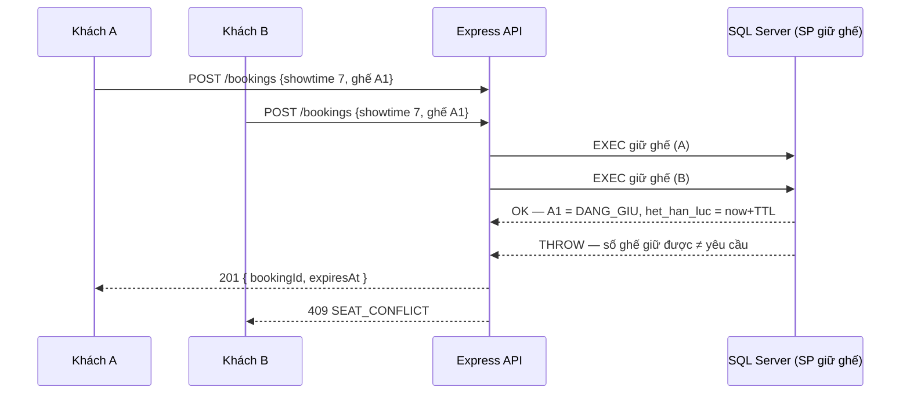

# BACKEND GUIDE FLOW — Hệ thống đặt vé xem phim trực tuyến (TROOND Cinema)

> Stack: **Node.js + TypeScript + Express + `mssql` (node-mssql) + SQL Server 2019+**
> DB: **CinemaBooking_Core_v2_1** — 14 bảng, 8 stored procedures. Mọi chuyển trạng thái nghiệp vụ (ghế / đơn / thanh toán / vé) **chỉ đi qua stored procedure**; API không `UPDATE` trực tiếp các bảng này.
> Auth: **JWT**, 2 vai trò `CUSTOMER` (bảng `KHACH_HANG`) và `ADMIN` (bảng `QUAN_TRI_VIEN`).
> Phạm vi: Backend cho 15 màn hình (C01–C09 khách hàng, A10–A15 quản trị), webhook thanh toán, worker (dọn ghế hết hạn, outbox phát hành vé / hoàn tiền).
> Bài toán trọng tâm của đề: **giao dịch nhiều bước (Giữ ghế → Thanh toán → Phát hành vé), hoàn tác nghiệp vụ, không bán trùng ghế, mọi bước có truy vết.**

---

## 1. Tổng quan kiến trúc

Phong cách: **Modular Monolith + Layered Architecture** (so sánh với Microservices ở mục 9).

```
Frontend (React/Vue)  ──  Authorization: Bearer <JWT>
        │
        ▼
┌───────────────────────────────────────────────────────────┐
│                  Express API (1 process)                  │
│  routes/version1 ─► services ─► repositories ─► SQL Server │
│                          │            (EXEC stored proc)   │
│                          └─► lib/ (paymentGateway, qr, mailer)
│  Modules: Auth · Movie · Cinema · Showtime · SeatHold ·    │
│           Booking · Payment · Ticket · Admin               │
└───────────────────────────────────────────────────────────┘
        │  webhook (có chữ ký)                 ▲
        ▼                                      │
 Cổng thanh toán (sandbox)          ┌──────────┴──────────┐
                                    │ jobs/ (worker)      │
                                    │ · seatExpiry        │
                                    │ · outboxWorker      │
                                    └─────────────────────┘
```

**Nguyên tắc:**
- SQL Server là nguồn quyết định quyền sở hữu ghế; không dùng cache để quyết định ghế còn trống.
- Không có layer `controller` riêng: `routes → services → repositories` (giữ đúng convention của base code).
- Service **không tự đổi trạng thái**; chỉ gọi stored procedure rồi map kết quả/lỗi sang HTTP.
- Callback thanh toán, phát hành vé, hoàn tiền đều **idempotent** (gọi lặp không tạo thêm vé / không giữ thêm ghế).

---

## 2. Cấu trúc thư mục (bám base code hiện có)

Giữ nguyên các thư mục đã có: `guide`, `migrations`, `src/{config,lib,middleware,repositories,routes,services,types,utils}`, `tests`. Chỉ **thêm** các file đánh dấu `(mới)`.

```
📦 Backend
 ┣ 📂 guide                         # tài liệu (file này, SCREEN_MAP..., DANH_GIA_DB...)
 ┣ 📂 migrations
 ┃ ┣ 📜 CinemaBooking_Core_v2_1.sql           # 14 bảng + 8 SP (nguồn sự thật của DB)
 ┃ ┗ 📜 CinemaBooking_Core_v2_1_demo_test.sql # test logic (không chạy trên DB production)
 ┣ 📂 src
 ┃ ┣ 📂 config
 ┃ ┃ ┣ 📜 db.config.ts            # mssql ConnectionPool dùng chung
 ┃ ┃ ┗ 📜 env.config.ts           # PORT, DB_*, JWT_SECRET, HOLD_TTL_MINUTES, PAYMENT_*...
 ┃ ┣ 📂 jobs                      # (mới) worker chạy cùng process hoặc tách process
 ┃ ┃ ┣ 📜 seatExpiry.job.ts       # gọi sp_giai_phong_ghe_het_han mỗi 5–15 giây
 ┃ ┃ ┗ 📜 outbox.worker.ts        # claim + xử lý OUTBOX_SU_KIEN (PHAT_HANH_VE / HOAN_TIEN)
 ┃ ┣ 📂 lib
 ┃ ┃ ┣ 📂 paymentGateway          # (mới) interface PaymentGateway { createPayment, verifyCallback, refund }
 ┃ ┃ ┣ 📂 qr                      # (mới) sinh ảnh QR từ qr_token
 ┃ ┃ ┗ 📂 mailer                  # (mới, tùy chọn) gửi vé qua email
 ┃ ┣ 📂 middleware
 ┃ ┃ ┣ 📜 auth.middleware.ts      # verify JWT, gắn req.user { id, role }
 ┃ ┃ ┣ 📜 requireRole.middleware.ts
 ┃ ┃ ┣ 📜 correlationId.middleware.ts   # (mới) gắn X-Correlation-Id vào log
 ┃ ┃ ┣ 📜 rateLimit.middleware.ts
 ┃ ┃ ┣ 📜 validateRequest.middleware.ts # zod
 ┃ ┃ ┗ 📜 errorHandler.middleware.ts    # map lỗi SQL (THROW 51xxx) → HTTP
 ┃ ┣ 📂 repositories              # chỉ chứa câu lệnh SQL / EXEC procedure
 ┃ ┃ ┣ 📜 auth.repository.ts
 ┃ ┃ ┣ 📜 catalog.repository.ts   # PHIM, CUM_RAP, PHONG_CHIEU, GHE, SUAT_CHIEU (đọc)
 ┃ ┃ ┣ 📜 booking.repository.ts   # giữ ghế, huỷ, đọc đơn/lịch sử
 ┃ ┃ ┣ 📜 payment.repository.ts   # tạo THANH_TOAN, gọi SP callback
 ┃ ┃ ┣ 📜 ticket.repository.ts    # sp_phat_hanh_ve, đọc VE
 ┃ ┃ ┣ 📜 outbox.repository.ts    # claim / đánh dấu kết quả event
 ┃ ┃ ┗ 📜 admin.repository.ts     # dashboard, trace, CRUD danh mục
 ┃ ┣ 📂 routes/version1
 ┃ ┃ ┣ 📜 auth.routes.ts · catalog.routes.ts · booking.routes.ts
 ┃ ┃ ┣ 📜 payment.routes.ts · webhooks.routes.ts · ticket.routes.ts
 ┃ ┃ ┣ 📜 admin.routes.ts · health.routes.ts (mới)
 ┃ ┃ ┗ 📜 index.ts
 ┃ ┣ 📂 services                  # logic + map DTO (TRONG→FREE ...)
 ┃ ┃ ┣ 📜 auth.service.ts · catalog.service.ts · seatMap.service.ts
 ┃ ┃ ┣ 📜 booking.service.ts · payment.service.ts · ticket.service.ts
 ┃ ┃ ┗ 📜 admin.service.ts
 ┃ ┣ 📂 types                     # booking.types.ts, payment.types.ts, common.types.ts...
 ┃ ┣ 📂 utils                     # logger.ts, apiResponse.ts, asyncHandler.ts, execProc.ts (mới)
 ┃ ┣ 📜 app.ts
 ┃ ┗ 📜 index.ts
 ┣ 📂 tests                       # concurrency.test.ts, callback.test.ts, expiry.test.ts
 ┣ 📜 .env · .env.example · package.json · tsconfig.json
```

**Luồng 1 request:** `routes` (validate + auth) → `services` (nghiệp vụ, map DTO) → `repositories` (EXEC procedure) hoặc `lib/*` (cổng thanh toán, QR).

---

## 3. Cơ sở dữ liệu (CinemaBooking_Core_v2_1)

### 3.1. 14 bảng

| Nhóm | Bảng | Vai trò |
|---|---|---|
| Tài khoản | `KHACH_HANG`, `QUAN_TRI_VIEN` | Đăng nhập, hash mật khẩu |
| Danh mục | `CUM_RAP`, `PHONG_CHIEU`, `GHE`, `PHIM`, `SUAT_CHIEU` | 10 cụm rạp / 100 phòng, sơ đồ ghế vật lý, lịch chiếu |
| Giao dịch | `DON_HANG`, `CHI_TIET_DON_HANG`, `GHE_SUAT_CHIEU`, `THANH_TOAN`, `VE` | Saga đặt vé; `CHI_TIET_DON_HANG` = snapshot ghế/giá |
| Truy vết / retry | `BUOC_GIAO_DICH`, `OUTBOX_SU_KIEN` | Nhật ký từng bước + hàng đợi sự kiện có retry |

### 3.2. Trạng thái và ánh xạ ra API/UI

| Bảng.cột | Giá trị DB | Ý nghĩa |
|---|---|---|
| `GHE_SUAT_CHIEU.trang_thai` | `TRONG` / `DANG_GIU` / `DA_BAN` | API trả `FREE` / `HELD` / `SOLD` |
| `DON_HANG.trang_thai` | `CHO_THANH_TOAN` | `PAYMENT_PENDING` (đang giữ ghế) |
| | `DA_THANH_TOAN` | `PAID` / `ISSUING` (đã nhận tiền, chờ phát vé) |
| | `HOAN_TAT` | `ISSUED` (đã có vé) |
| | `THAT_BAI` / `HET_HAN` | `FAILED` / `EXPIRED` (ghế đã giải phóng) |
| | `CHO_HOAN_TIEN` | `REFUND_REVIEW` (tiền đến nhưng đơn không còn hợp lệ) |
| `THANH_TOAN.trang_thai` | `CHO`, `THANH_CONG`, `THAT_BAI`, `CHO_HOAN_TIEN` | Theo từng lần thanh toán (`ma_yeu_cau` duy nhất) |
| `OUTBOX_SU_KIEN.loai_su_kien` | `PHAT_HANH_VE`, `HOAN_TIEN` | `event_key` duy nhất: `ISSUE:<id_don>` / `REFUND:<id_tt>` |
| `BUOC_GIAO_DICH` | `ten_buoc` (`GIU_GHE`, `THANH_TOAN`, `PHAT_HANH_VE`), `hanh_dong` (`THUC_HIEN`/`BU_TRU`), `trang_thai` | Mỗi bước và mỗi lần hoàn tác đều có dòng log |

> Đơn `DA_THANH_TOAN` mà event `ISSUE` ở trạng thái `THAT_BAI` → API trả `ISSUE_RETRY`.

### 3.3. Stored procedures (backend chỉ gọi, không viết lại logic)

| Chức năng | Procedure | Tham số chính | Gọi từ |
|---|---|---|---|
| Giữ ghế nguyên tử, tạo đơn `CHO_THANH_TOAN` | *(xác nhận tên — mục 10)* | suất chiếu, danh sách ghế, khách hàng | `POST /bookings` |
| Xử lý callback thanh toán (idempotent) | *(xác nhận tên — mục 10)* | `@ma_yeu_cau`, `@thanh_cong`, `@ma_giao_dich_cong`, `@so_tien_gateway` | webhook |
| Phát hành vé | `sp_phat_hanh_ve` | `@id_don_hang` | worker + gọi ngay sau thanh toán |
| Giải phóng ghế hết hạn | `sp_giai_phong_ghe_het_han` | — | job 5–15 giây |
| Huỷ đơn chưa thanh toán | `sp_huy_don_chua_thanh_toan` | `@id_don_hang`, `@id_khach_hang` | `POST /bookings/:id/cancel` |
| Tạo suất chiếu (chống chồng lịch phòng) | `sp_tao_suat_chieu` | phim, phòng, giờ... | `POST /admin/showtimes` |
| 2 procedure còn lại | *(xác nhận — mục 10)* | | |

### 3.4. Lỗi từ procedure → HTTP (`errorHandler.middleware.ts`)

| Mã `THROW` | Ý nghĩa | HTTP | `code` |
|---|---|---|---|
| (giữ ghế: số ghế cập nhật ≠ số ghế yêu cầu) | Ghế đã bị giữ/bán | **409** | `SEAT_CONFLICT` |
| 51302 | Đơn không có ghế | 422 | `ORDER_EMPTY` |
| 51303 | Ghế không nhất quán, cần đối soát | 500 | `SEAT_INCONSISTENT` |
| 51400 | Đơn chưa được xác nhận thanh toán | 409 | `ORDER_NOT_PAID` |
| 51401 / 51402 | Số ghế bán/vé phát hành không khớp | 500 | `ISSUE_INCONSISTENT` |

Lỗi khác → 500 `INTERNAL`, log kèm `correlationId`.

---

## 4. Xác thực & phân quyền

- `POST /auth/register`, `POST /auth/login` → bảng `KHACH_HANG` → JWT `{ sub, role: 'CUSTOMER' }`.
- `POST /admin/auth/login` → bảng `QUAN_TRI_VIEN` → JWT `{ sub, role: 'ADMIN' }`.
- Mật khẩu hash bằng `bcrypt`; JWT hết hạn ngắn (vd 1 giờ).
- `requireRole('CUSTOMER')` cho `/bookings*`, `/payments*`, `/tickets*`; `requireRole('ADMIN')` cho `/admin/*`.
- **Quyền sở hữu:** khách chỉ đọc/huỷ/thanh toán đơn có `id_khach_hang` = chính mình.
- Webhook không dùng JWT; xác thực bằng **chữ ký của cổng thanh toán**.

---

## 5. API Endpoints (prefix `/api/v1`)

### 5.1. Khách hàng (C01–C09)

| Màn | Method | Endpoint | Mô tả |
|---|---|---|---|
| C01 | POST | `/auth/register`, `/auth/login` | Đăng ký / đăng nhập |
| C02 | GET | `/movies?status=` | Phim đang chiếu |
| C03 | GET | `/movies/:id` | Chi tiết phim |
| C04 | GET | `/cinemas` | Danh sách cụm rạp |
| C04 | GET | `/showtimes?movieId=&cinemaId=&date=` | Suất chiếu theo phim/rạp/ngày |
| C05 | GET | `/showtimes/:id/seats` | Sơ đồ ghế `FREE/HELD/SOLD` + hạn giữ |
| C05 | POST | `/bookings` | Giữ ghế. Body `{ showtimeId, seatIds[] }`, header `Idempotency-Key`. 201 `{ bookingId, expiresAt }` hoặc **409** |
| C06 | GET | `/bookings/:id` | Trạng thái đơn + `remainingSeconds` |
| C06 | POST | `/bookings/:id/payments` | Tạo `THANH_TOAN` (`ma_yeu_cau`), trả `paymentUrl` của cổng |
| C06 | POST | `/bookings/:id/cancel` | Huỷ đơn chưa thanh toán (`sp_huy_don_chua_thanh_toan`) |
| C07 | GET | `/bookings/:id/tickets` | Vé điện tử (`ma_ve`, `qr_token`/ảnh QR) |
| C08 | GET | `/bookings/:id` | Trạng thái `FAILED`/`EXPIRED`/`REFUND_REVIEW` + lý do |
| C09 | GET | `/bookings?page=` | Lịch sử đặt vé của khách |

### 5.2. Webhook

| Method | Endpoint | Mô tả |
|---|---|---|
| POST | `/webhooks/payment/:gateway` | Verify chữ ký, số tiền, đơn vị tiền, nguồn → gọi SP callback (mục 6.3) |

### 5.3. Quản trị (A10–A15, JWT `ADMIN`)

| Màn | Method | Endpoint | Mô tả |
|---|---|---|---|
| A10 | GET | `/admin/dashboard` | KPI: số đơn theo trạng thái, doanh thu, vé phát hành, event lỗi |
| A11 | CRUD | `/admin/movies` | Quản lý phim |
| A12 | CRUD | `/admin/cinemas`, `/admin/rooms`, `/admin/rooms/:id/seats` | Cụm rạp / phòng / sơ đồ ghế. **Chặn sửa/xoá ghế** nếu phòng có suất đang mở bán |
| A13 | POST | `/admin/showtimes` | Qua `sp_tao_suat_chieu` |
| A13 | PUT/DELETE | `/admin/showtimes/:id` | Chặn khi suất có ghế `DANG_GIU` hoặc vé đã bán |
| A14 | GET | `/admin/showtimes/:id/seats` | Giám sát ghế trống/giữ/bán + TTL |
| A15 | GET | `/admin/bookings`, `/admin/bookings/:id/trace` | Danh sách đơn; trace từ `BUOC_GIAO_DICH` |
| A15 | GET | `/admin/outbox?status=` | Event `CHO`/`THAT_BAI` |
| A15 | POST | `/admin/outbox/:id/retry` | Đặt lại `xu_ly_sau` để worker xử lý |

### 5.4. Khác
`GET /health` (kiểm tra kết nối DB, dùng cho giám sát uptime).

---

## 6. Logic nghiệp vụ chi tiết

### 6.1. Giữ ghế (C05) — chống bán trùng



- Việc "kiểm tra trống + giữ" là **một lệnh nguyên tử trong SP** (khoá dòng `GHE_SUAT_CHIEU`, ràng buộc duy nhất `(id_suat_chieu, id_ghe)`); API không SELECT trước rồi UPDATE sau.
- Ghế `DANG_GIU` đã quá `het_han_luc` được coi là trống và có thể giữ lại ngay, không cần chờ job.
- Header `Idempotency-Key`: gửi lại cùng key trả lại đơn cũ, không tạo đơn thứ hai.
- TTL lấy từ `HOLD_TTL_MINUTES` (5–10 phút, đề xuất 7).

### 6.2. Bắt đầu thanh toán (C06)
1. Kiểm tra đơn thuộc khách và đang `CHO_THANH_TOAN`, chưa quá `het_han_luc`.
2. Tạo dòng `THANH_TOAN` (`trang_thai='CHO'`, `ma_yeu_cau` duy nhất, `so_tien` = `tong_tien` của đơn).
3. `paymentGateway.createPayment()` → trả `paymentUrl` cho FE. FE hiển thị đồng hồ đếm ngược từ `remainingSeconds`.

### 6.3. Webhook thanh toán (C07/C08)
1. Verify chữ ký, số tiền, đơn vị tiền, nguồn; sai → 400/401, **không** gọi DB.
2. Gọi SP callback với `ma_yeu_cau`, kết quả, `ma_giao_dich_cong`, số tiền cổng báo.
3. Kết quả do SP quyết định (backend không tự suy luận):

| Tình huống | Kết quả trong DB |
|---|---|
| Thành công, đơn còn hạn, đúng số tiền | Ghế `DA_BAN`, đơn `DA_THANH_TOAN`, tạo event `ISSUE:<id>` |
| Cổng báo thất bại | Ghế về `TRONG` (log `BU_TRU`), đơn `THAT_BAI` |
| Thành công nhưng đơn hết hạn / sai số tiền | Giải phóng ghế, `THANH_TOAN` + `DON_HANG` = `CHO_HOAN_TIEN`, tạo event `REFUND:<id>` |
| Thất bại rồi thành công (đến muộn) | Không phục hồi ghế, không cấp vé; chuyển hoàn tiền |
| Callback gửi lặp | SP thoát sớm, không tạo thêm gì |

4. Luôn trả **200** cho cổng sau khi SP commit (kể cả callback lặp) để cổng ngừng retry.
5. Nếu đơn vừa sang `DA_THANH_TOAN`: gọi ngay `sp_phat_hanh_ve` (không chờ worker) để đạt phát hành vé < 5 giây; nếu lỗi, event outbox sẽ được worker retry.

### 6.4. Phát hành vé
- `sp_phat_hanh_ve` idempotent: đơn đã `HOAN_TAT` thì trả về ngay; chỉ sinh vé khi số ghế `DA_BAN` khớp `CHI_TIET_DON_HANG`.
- Lỗi phát hành **không** giải phóng ghế đã bán; ghi `BUOC_GIAO_DICH` (`PHAT_HANH_VE`, `THAT_BAI`), tăng `so_lan_thu`, đặt `xu_ly_sau` = +30 giây.
- `ticket.service` trả `ma_ve` và `qr_token`; ảnh QR sinh bằng `lib/qr`. Gửi email là tùy chọn (`lib/mailer`).

### 6.5. Dọn ghế hết hạn — `jobs/seatExpiry.job.ts`
- Chạy mỗi 5–15 giây (`setInterval` có khoá chống chạy chồng), gọi `sp_giai_phong_ghe_het_han`.
- SP chỉ xử lý đơn `CHO_THANH_TOAN` quá hạn: đơn → `HET_HAN`, ghế → `TRONG`, ghi `BU_TRU`. **Không bao giờ** động tới ghế đã `DA_BAN`.

### 6.6. Huỷ đơn chưa thanh toán
`POST /bookings/:id/cancel` → `sp_huy_don_chua_thanh_toan(@id_don_hang, @id_khach_hang)`. Đơn đã thanh toán không huỷ qua đường này.

### 6.7. Outbox worker — `jobs/outbox.worker.ts`
- **Claim độc quyền** (an toàn khi chạy nhiều worker), chỉ dùng cột sẵn có:

```sql
UPDATE TOP (@batch) o
SET xu_ly_sau = DATEADD(SECOND, 60, SYSUTCDATETIME())      -- lease 60 giây
OUTPUT inserted.*
FROM dbo.OUTBOX_SU_KIEN o WITH (UPDLOCK, READPAST, ROWLOCK)
WHERE o.trang_thai IN ('CHO','THAT_BAI')
  AND (o.xu_ly_sau IS NULL OR o.xu_ly_sau <= SYSUTCDATETIME());
```

- `PHAT_HANH_VE` → `sp_phat_hanh_ve(id_don_hang)`.
- `HOAN_TIEN` → `paymentGateway.refund()` với idempotency key = `event_key`; thành công thì cập nhật trạng thái hoàn tiền (xem mục 10).
- Quá `MAX_RETRY` (vd 5) → ghi log mức ERROR / cảnh báo; để admin xử lý ở A15.
- Chu kỳ poll 1–2 giây để không làm trễ phát hành vé.

### 6.8. Sơ đồ ghế (C05, A14)
Một truy vấn duy nhất trên `GHE` ⟕ `GHE_SUAT_CHIEU` theo suất chiếu (không N+1). `seatMap.service` map: `TRONG`→`FREE`; `DANG_GIU` còn hạn →`HELD` (kèm `expiresAt`); `DANG_GIU` quá hạn →`FREE`; `DA_BAN`→`SOLD`. FE có thể poll 3–5 giây hoặc dùng SSE; **việc quyết định ghế còn trống luôn do bước giữ ghế (6.1) chốt**.

### 6.9. Bảo vệ dữ liệu quản trị (A12, A13)
Vì DB không chặn mọi `UPDATE` trực tiếp, `admin.service` phải kiểm tra trước khi sửa/xoá ghế, phòng, suất chiếu: không có ghế `DANG_GIU`, không có vé `HOP_LE` của suất đó. Ghế loại `DOI` chỉ lưu thuộc tính; nếu demo không dùng ghế đôi thì chỉ dùng `THUONG`/`VIP`.

### 6.10. Quan sát và truy vết
- `correlationId` (header `X-Correlation-Id` hoặc tự sinh) xuất hiện ở mọi dòng log và trong thông điệp lỗi.
- Trace nghiệp vụ nằm ở `BUOC_GIAO_DICH`, trả qua `GET /admin/bookings/:id/trace` (sắp theo thời gian).

---

## 7. Đối chiếu yêu cầu đề bài và kế hoạch kiểm chứng

| Yêu cầu đề | Cách đáp ứng ở backend | Cách chứng minh (đưa vào báo cáo) |
|---|---|---|
| Không bán trùng ghế | Giữ ghế nguyên tử trong SP + `UNIQUE(id_suat_chieu, id_ghe)`; 409 cho người thua | `tests/concurrency.test.ts`: 2–50 request song song cùng ghế → đúng 1 thành công |
| Ghế giữ tạm hết hạn 5–10 phút, tự giải phóng | `het_han_luc` + job 5–15 giây + SP callback kiểm tra hạn sau khi lấy khoá | `tests/expiry.test.ts`; test thanh toán đến sau TTL |
| Thanh toán lỗi/quá hạn phải hoàn tác | SP callback + `BU_TRU` trong `BUOC_GIAO_DICH` | Test thất bại, thất bại→thành công, trùng callback |
| Mọi bước có trạng thái truy vết | `BUOC_GIAO_DICH`, `OUTBOX_SU_KIEN`, `correlationId` | Ảnh màn A15 trace + log |
| Xem lịch/sơ đồ ghế < 1s | Truy vấn đơn, index theo `(id_phim, thoi_gian_bat_dau)` và `(id_suat_chieu, id_ghe)` | k6/autocannon, báo cáo P95 |
| Giữ ghế < 2s | 1 lần EXEC SP | Load test P95 |
| Phát hành vé < 5s | Gọi `sp_phat_hanh_ve` ngay sau thanh toán; worker poll 1–2s làm lưới an toàn | Đo từ lúc webhook nhận đến lúc có `VE` |
| 10 cụm rạp, 100 phòng, 5.000–10.000 đơn/ngày | Connection pool, truy vấn có index; trung bình ~0,1 đơn/giây, giờ cao điểm vài chục/giây | Load test tăng dần, chỉ ra điểm nghẽn |
| Uptime ≥ 99,5% | `/health`, graceful shutdown, retry outbox, log | Cần thêm hạ tầng/giám sát (ngoài phạm vi code) |

> Cam kết trung thực cho báo cáo: DDL và code **không tự chứng minh** hiệu năng, uptime và tải đồng thời; phải có số liệu chạy thật.

---

## 8. Thứ tự triển khai (Roadmap)

1. Chạy `migrations/CinemaBooking_Core_v2_1.sql` trên SQL Server 2019+; xác nhận tên và tham số 8 procedure (mục 10).
2. `db.config.ts` (ConnectionPool), `utils/execProc.ts`, `env.config.ts`, `logger`, `correlationId`, `errorHandler`.
3. Auth + phân quyền (C01, đăng nhập admin).
4. Catalog đọc: phim, cụm rạp, suất chiếu, sơ đồ ghế (C02–C04, phần đọc của C05).
5. **Giữ ghế + 409** (`POST /bookings`) và test tranh chấp đồng thời — làm sớm vì là lõi của đề.
6. Thanh toán: tạo `THANH_TOAN`, adapter cổng sandbox, webhook (C06–C08).
7. Phát hành vé + QR (C07), lịch sử (C09).
8. Jobs: `seatExpiry`, `outboxWorker` (phát vé, hoàn tiền).
9. Admin: CRUD danh mục có chặn sửa khi đang bán (A11–A13), giám sát ghế (A14), giao dịch/trace/retry (A15), dashboard (A10).
10. Hardening và đo: rate limit, `/health`, load test, hoàn thiện báo cáo QAS.

---

## 9. Quyết định đã chốt

| Vấn đề | Quyết định |
|---|---|
| Kiến trúc | Modular Monolith + Layered. Microservices cho scale độc lập nhưng thêm giao dịch phân tán và chi phí vận hành; quy mô 10 cụm rạp/100 phòng chưa cần. Điều kiện tách sau này: module Payment/Ticket cần scale riêng hoặc đội phát triển tách |
| DB | SQL Server 2019+ (không dùng PostgreSQL); báo cáo và 4+1 Views phải ghi nhất quán |
| Truy cập DB | `mssql` + gọi stored procedure; không ORM |
| Quyền sở hữu ghế | Chỉ SQL Server quyết định; Redis (nếu dùng) chỉ cache/thông báo, không bắt buộc |
| Hoàn tác | Saga có bù trừ: log `BU_TRU` trong `BUOC_GIAO_DICH` |
| Phát hành vé / hoàn tiền | Outbox + worker, idempotent, retry; không bao giờ giải phóng ghế đã thanh toán |
| Thanh toán | Adapter `PaymentGateway`, chạy sandbox; webhook bắt buộc xác thực chữ ký |
| Phân quyền | Tối thiểu `ADMIN` / `CUSTOMER` |
| Cắt giảm | Voucher, bình luận/đánh giá, bài viết, combo đồ ăn, quản lý nhân viên chuyên sâu, quên/đổi mật khẩu |

---

## 10. Điểm cần xác nhận với file `CinemaBooking_Core_v2_1.sql` trước khi code

Guide này được viết từ đoạn procedure đã có và tài liệu kiểm định; các mục dưới đây chưa thấy trong tài liệu nên **không được đoán**:

- [ ] Tên và tham số chính xác của procedure **giữ ghế** và **callback thanh toán** (đoạn đầu procedure callback chưa có trong tài liệu).
- [ ] 2 procedure còn lại trong tổng 8 là gì.
- [ ] Danh sách ghế truyền vào SP giữ ghế theo dạng nào (table-valued parameter, JSON hay chuỗi) — quyết định cách viết `booking.repository.ts`.
- [ ] TTL giữ ghế là tham số hay hằng số trong SP; cách đặt `het_han_luc` của đơn.
- [ ] Giá trị đầy đủ của `DON_HANG.trang_thai` (có `DA_HUY`/`DA_HOAN_TIEN` hay không) và `OUTBOX_SU_KIEN.trang_thai`.
- [ ] Cách đánh dấu **hoàn tiền xong** (`THANH_TOAN` → hoàn tiền, `DON_HANG` → hoàn tiền): đã có SP chưa. Nếu chưa, cần thêm một SP riêng (không UPDATE trực tiếp từ API).
- [ ] Framework hiện tại trong `package.json` (guide giả định Express vì cấu trúc `routes/services/repositories` giống nhau). Tài liệu kiểm định có nhắc "ASP.NET Core"; nếu báo cáo ghi như vậy phải sửa thành Node.js + TypeScript cho khớp với code đang có.