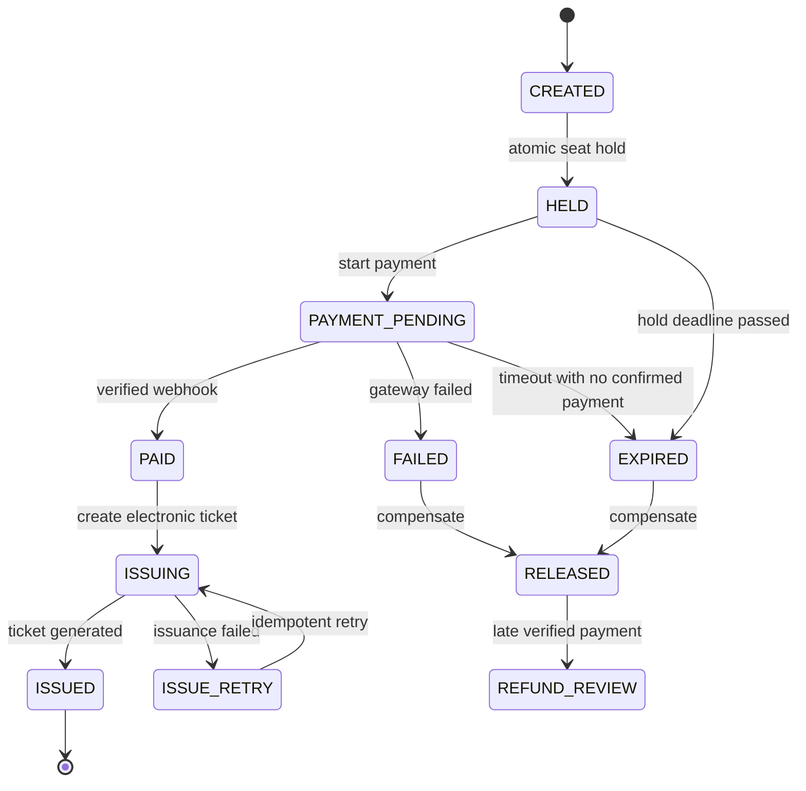

Bản đồng bộ công nghệ với CinemaBooking_Core_v2_1.sql (SQL Server 2019+).
Thiết kế giao diện 15 màn giữ nguyên. Đây là quyết định công nghệ của phương án triển khai, không phải thay đổi chức năng.

Ma trận phạm vi giao diện & yêu cầu kiến trúc
I. Phạm vi cốt lõi
Mã	Giao diện	Yêu cầu đề bài
C01	Đăng nhập / Đăng ký	Người dùng có thể truy cập đơn đặt vé của mình
C02	Trang chủ / Phim đang chiếu	Khám phá phim và bắt đầu giao dịch
C03	Chi tiết phim	Thời lượng, nội dung, chọn phim
C04	Chọn rạp, ngày và suất chiếu	Lịch chiếu gắn với rạp/phòng/suất chiếu
C05	Sơ đồ ghế và giữ ghế	FREE/HELD/SOLD, đồng hồ giữ 5–10 phút, tranh chấp đồng thời
C06	Thanh toán đang chờ	PENDING, hạn giao dịch, xác minh gateway
C07	Thanh toán thành công & vé điện tử	PAID → ISSUED, mã vé, QR minh họa
C08	Thanh toán thất bại / hết hạn	FAILED/EXPIRED, RELEASED, hướng xử lý thanh toán đến muộn
C09	Lịch sử đặt vé	Truy vết đơn, trạng thái thanh toán, trạng thái phát hành vé
A10	Dashboard	Tổng quan chỉ tiêu vận hành và tình trạng giao dịch
A11	Quản lý phim	CRUD thông tin phim
A12	Cụm rạp & phòng	Quản lý 10 cụm rạp / 100 phòng, ghế trực thuộc phòng
A13	Suất chiếu	CRUD và kiểm tra trùng phòng/thời gian
A14	Giám sát sơ đồ ghế	Trạng thái ghế trong từng suất chiếu, giữ/giải phóng
A15	Quản lý giao dịch & vé	Nhiều bước, trace, phát hành vé, timeout, đối soát và retry

Chức năng được cắt giảm
Voucher, bình luận/đánh giá, bài viết, combo đồ ăn, quản lý nhân viên chuyên sâu, phân quyền chi tiết, quên/đổi mật khẩu và phim sắp chiếu chuyên biệt. Phân quyền tối thiểu giữa ADMIN và CUSTOMER vẫn phải triển khai ở backend, dù không có màn cấu hình riêng.
II. Vòng đời giao dịch

Lưu ý: RELEASED → REFUND_REVIEW là trạng thái xử lý khoản tiền thanh toán đến muộn; không phải ghế đã giải phóng tự trở về trạng thái bán cho giao dịch cũ. Khi gateway có trạng thái chưa rõ cần giữ một quy trình đối soát riêng để không xử lý sai.
III. Chống bán trùng một ghế
CSDL đề xuất bảng GHE_SUAT_CHIEU khóa chính (id_suat_chieu, id_ghe). Cấp giữ ghế trong một transaction: khóa hàng ghế (SELECT ... WITH (UPDLOCK, HOLDLOCK)) hoặc UPDATE ... WHERE nguyên tử chỉ khi ghế đang trống hoặc hạn giữ trước đã hết; nếu số hàng cập nhật khác 1 thì trả 409 CONFLICT. Ghi id_don_hang, het_han_luc, trạng thái. Cổng thanh toán phải có provider_transaction_id unique, xử lý webhook theo idempotency key. Khi PAID, đánh dấu quyền sở hữu ghế đã bán trong transaction và phát hành vé bằng outbox/worker; nếu phát hành thất bại, giữ trạng thái ISSUING/ISSUE_RETRY (không giải phóng ghế).

Redis nếu dùng chỉ để cache/push thông báo/timer UI; SQL Server là nguồn dữ liệu quyết định quyền sở hữu ghế.
IV. Kiến trúc khuyến nghị và đánh đổi
- Đề xuất: Modular Monolith + Layered Architecture, các module Auth, Movie, Cinema, Showtime, SeatHold, Booking, Payment, Ticket, Admin. SQL Server, Redis (tùy chọn), worker, API backend, frontend React/Vue, Docker và reverse proxy.
- So sánh: Microservices cho phép scale độc lập, triển khai tách rời nhưng tăng độ phức tạp giao dịch phân tán và vận hành; ở mức 10 cụm rạp/100 phòng, Modular Monolith có thể là phương án khởi đầu hợp lý khi tối ưu chi phí và thời gian học phần. Nêu điều kiện tách dịch vụ sau này.
- Nên áp dụng outbox, retry idempotent, log correlation ID, dashboard giám sát và sao lưu CSDL.
V. 4+1 Views cho báo cáo
View	Nội dung cần vẽ
Logical View	Module diagram + domain entities: Cinema, Room, Seat, Showtime, Booking, SeatHold, Payment, Ticket
Process View	Sequence diagram giữ ghế đồng thời; thanh toán thành công; timeout & compensation; callback đến muộn
Development View	Module/project/package structure; ports & adapters, API ↔ business ↔ DB
Physical View	Frontend + API + SQL Server + Redis (tùy chọn) + worker + payment gateway, network/security, backups
+1 Scenarios	Chọn ghế, giữ ghế, fail/expire, confirm paid, retry ticket, 2 khách tranh cùng 1 ghế

VI. Ba kịch bản chất lượng (QAS) tối thiểu
1. Hiệu năng: Khi khách hàng tra cứu lịch/sơ đồ ghế tại giờ cao điểm, hệ thống phản hồi <1 giây; giữ ghế <2 giây; phát hành vé sau xác minh thanh toán <5 giây. Dùng load testing để đo theo phân vị (ví dụ P95) và tỷ lệ lỗi, đồng thời báo cáo điều kiện thử nghiệm.
2. Sẵn sàng và nhất quán: Dưới cùng một suất chiếu, khi hai người cùng đặt một ghế, đúng một transaction giữ ghế thành công; transaction còn lại nhận conflict, không phát sinh 2 vé bán cho 1 ghế. Khi thanh toán thất bại/quá hạn, hệ thống giải phóng ghế an toàn. Mục tiêu uptime ≥99,5%; mô phỏng lỗi gateway và worker.
3. Khả năng mở rộng: Thiết kế đáp ứng 10 cụm rạp, 100 phòng, 5.000–10.000 giao dịch/ngày. Đo throughput/độ trễ trong các mức tăng tải; chỉ ra bottleneck ở truy vấn ghế, kết nối CSDL, payment gateway, worker và phương án scale có kiểm chứng.
Bản thiết kế Figma không tự chứng minh các QAS: cần mã backend, test tranh chấp, tích hợp gateway sandbox, load test và dữ liệu giám sát thực tế để bảo vệ bài.